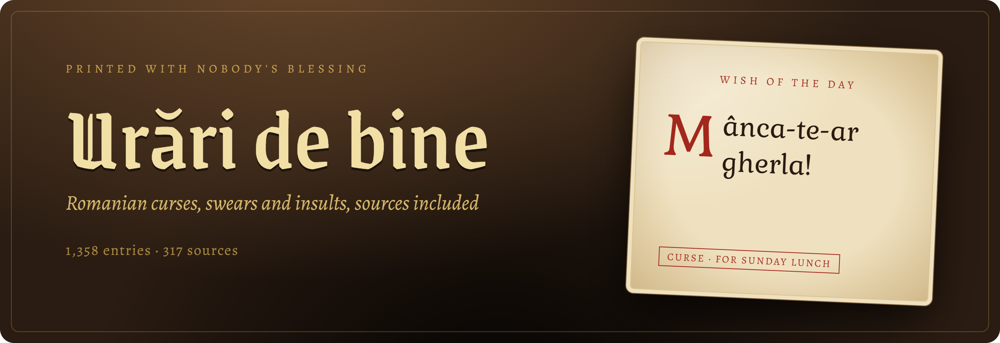
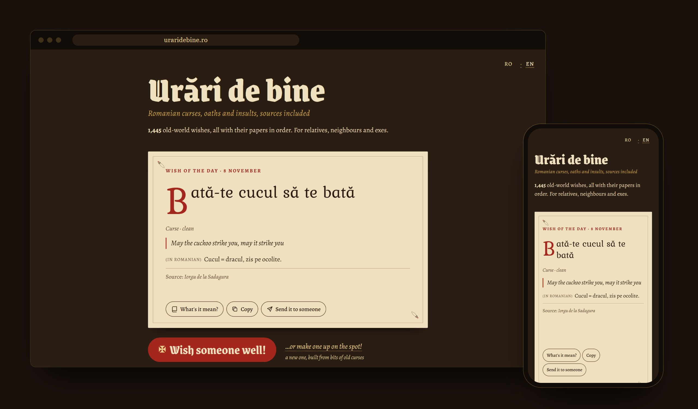

<div align="center">



<br>

**Over 1,300 Romanian curses, swears and insults, collected from old books, dictionaries and the internet. Each one says where it came from.**<br>
Read them on the site or get them from the API.

<br>

[](data/entries/)
[](https://api.uraridebine.ro/v1/sources)
[](https://api.uraridebine.ro/docs)
[](data/LICENSE)
[](LICENSE)
[](https://ko-fi.com/bogdantoma27)

**[Website](https://uraridebine.ro)** · **[API docs](https://api.uraridebine.ro/docs)** · **[All entries](https://uraridebine.ro/all)** · **[Contribute](CONTRIBUTING.md)** · **[Română](README.md)**

</div>

<br>



## What is this

*Urări de bine* is Romanian for “good wishes”. It's the polite name for a collection of the least polite things Romanians have ever wished on each other.

“Mânca-te-ar gherla” (may the prison eat you), “Pieie-i boii din ogor” (may his oxen die in the field), “Crapă-ți-ar oala de sarmale și seca-ți-ar butoiul de țuică” (may your cabbage-roll pot burst and your plum-brandy barrel dry up). Our grandparents had a gift nobody had ever written down in one place. So I did.

I dug through 19th-century folklore collections, dialect atlases, dictionaries, novels, newspapers and Reddit threads. Each formula says where it came from. I checked 1,168 of them word for word against the original text. The rest were copied from other sources or I couldn't find them again, and the entry says so.

When you open the site, the wish of the day is already on the page. Then there are two buttons. **Wish someone well!** gives you a real one, picked from the funniest. **…or make one up on the spot!** builds a new one out of pieces of real curses. If you want them in your own app, there's the API.

## API

```bash
curl https://api.uraridebine.ro/v1/random
```

```json
{
  "id": "manca-te-ar-gherla",
  "text": "Mânca-te-ar gherla!",
  "type": "curse",
  "level": "clean",
  "regions": [],
  "explanation": "Gherla = pușcăria, după închisoarea din Gherla.",
  "translation": "May the prison eat you!",
  "source": "Imaginarul blestemului. Imaginea culturală a blestemului (Journal of Romanian Literary Studies 20/2020)",
  "url": "https://api.uraridebine.ro/v1/entries/manca-te-ar-gherla"
}
```

Field names and values are in English. The curses themselves and their explanations stay in Romanian, and every entry has an English translation in `translation`.

A few more examples:

```bash
# just the text, handy for a terminal or a bot
curl "https://api.uraridebine.ro/v1/random?format=text"

# a church-themed curse from Moldova
curl "https://api.uraridebine.ro/v1/random?type=curse&theme=church&region=moldavia"

# safe for Sunday lunch with the in-laws
curl "https://api.uraridebine.ro/v1/random?level=clean&format=text"

# search, diacritics optional
curl "https://api.uraridebine.ro/v1/entries?q=gherla"

# a new one, built from pieces of real curses
curl "https://api.uraridebine.ro/v1/generate?format=text"

# the wish of the day, the same for everyone today
curl "https://api.uraridebine.ro/v1/today?format=text"
```

> [!TIP]
> By default you get every level, vulgar included. If you only want what can be said in front of children, add `level=clean`.

### Routes

| Route | What it does |
|---|---|
| `GET /v1/random` | a random formula with some bite. With `seed` and `n` it walks every matching formula once: the ones with bite first, then the rest (the button on the site sends `sensitive=false`, so no slurs). With `?format=text` or `Accept: text/plain` you get just the text |
| `GET /v1/today` | the wish of the day: the same for everyone, changes at midnight Romanian time |
| `GET /v1/generate` | a new curse built from pieces of real ones (“Verb-te-ar *affliction*” style, or built around “mă-tii”). The response says clearly that it's generated |
| `GET /v1/entries` | every entry, with filters, search and paging (`page`, `per_page` ≤ 100) |
| `GET /v1/entries/{id}` | one full entry, with all its sources |
| `GET /v1/themes` · `/v1/regions` · `/v1/sources` | themes, regions and sources, with the number of entries in each |

The shared filters are `type`, `theme`, `region`, `level`, `form`, `attested` and `q`. Separate multiple values with a comma (`type=curse,insult`). `/v1/generate` only takes `level`, `theme` and `sensitive`, and `funny` only works on `/v1/entries`. `sensitive=false` drops the slurs against groups.

You don't need a key, and you can call it straight from the browser on any domain. The limit is 120 requests per minute per IP. The docs, where you can try requests right in the page, are at **[api.uraridebine.ro/docs](https://api.uraridebine.ro/docs)**, in English and Romanian. The OpenAPI spec is at `/openapi.en.json` and `/openapi.json`.

## What's in the collection

| | |
|---|---|
| **Types** | 598 curses · 316 swears · 260 insults · 126 expressions · 58 euphemisms |
| **Levels** | 1,040 clean (fine at Sunday lunch) · 102 mild (traffic jams) · 216 vulgar (football stands) |
| **Verification** | 1,091 found word for word in the source · 265 copied by hand · 2 not found |
| **Regions** | from Maramureș to Dobruja, plus Aromanian, Megleno-Romanian, Istro-Romanian and the Romanians of Ukraine |
| **Age** | sources from 1844 to today |
| **With bite** | 242, hand-picked for the button on the site |

<details>
<summary><b>What an entry looks like</b></summary>

```json
{
  "id": "manca-te-ar-gherla",
  "text": "Mânca-te-ar gherla!",
  "original_text": "Mînca-te-ar gherla!",
  "type": "curse",
  "form": "optative",
  "affliction": "gherla",
  "themes": ["prison"],
  "regions": [],
  "level": "clean",
  "attested": true,
  "verification": "verified",
  "sensitive": false,
  "funny": true,
  "sources": [{ "title": "Imaginarul blestemului…", "author": "Lavinia Nasta", "year": 2020, "original_text": "Mînca-te-ar gherla!", "verification": "verified" }],
  "explanation": "Gherla = pușcăria, după închisoarea din Gherla.",
  "translation": "May the prison eat you!"
}
```


Each wish is a JSON file in [`data/entries/`](data/entries/). Every field is described in [schema/entry.schema.json](schema/entry.schema.json).

</details>

## Contributing

Know a curse your grandma used? Send it over.

- **No git:** open an issue with the [“New entry” template](../../issues/new?template=new-entry.yml).
- **With git:** add a file to `data/entries/` and send a PR. CI checks the schema for you.

The golden rule is the source: a book, an article, or “heard from my grandma, Breaza village, Suceava county”. Nothing that targets real people. The rest is in [CONTRIBUTING.md](CONTRIBUTING.md).

To run it locally: `npm install`, then `npm run dev` starts the site, the API and `/docs` on `localhost:8787`, and `npm test` runs the tests and validates the data. You need Node 22+.


## License

The data is under [CC BY-SA 4.0](data/LICENSE), the code under [MIT](LICENSE). Folk formulas have no author; the explanations, translations and classification are mine. Cite it as “Urări de bine (uraridebine.ro), CC BY-SA 4.0”, and for a single formula add its own source from `sources`. If you wrote one of the sources and want a formula removed, open an issue.

<br>

<div align="center">
<sub>Printed with nobody's blessing. May all good things eat you!</sub>
</div>
