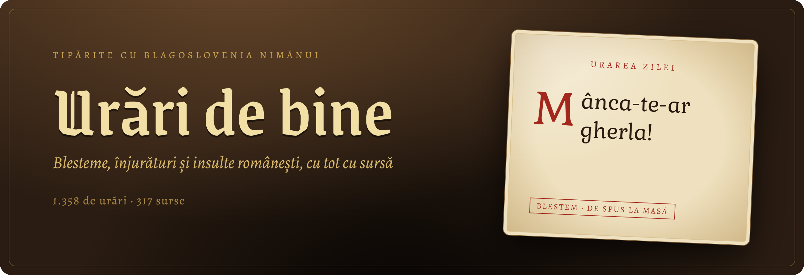
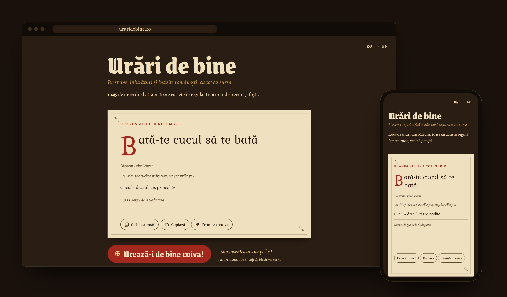

<div align="center">



<br>

**Peste 1.400 de blesteme, înjurături și insulte românești, adunate din cărți vechi, dicționare și de pe internet. La fiecare scrie de unde e luată.**<br>
Le poți citi pe site sau le poți lua din API.

<br>

[](data/entries/)
[](https://api.uraridebine.ro/v1/sources)
[](https://api.uraridebine.ro/docs)
[](data/LICENSE)
[](LICENSE)

**[Site](https://uraridebine.ro)** · **[Documentația API](https://api.uraridebine.ro/docs)** · **[Toate formulele](https://uraridebine.ro/all)** · **[Contribuie](CONTRIBUTING.md)** · **[English](README.en.md)**

</div>

<br>



## Ce e asta

„Mânca-te-ar gherla”, „Pieie-i boii din ogor”, „Crapă-ți-ar oala de sarmale și seca-ți-ar butoiul de țuică”. Bunicii știau să blesteme cum nu mai știe nimeni azi, dar nu le adunase nimeni într-un singur loc. Așa că m-am apucat eu.

Am scotocit prin culegeri de folclor din 1800 și ceva, atlase lingvistice, dicționare, romane, ziare și pe Reddit. La fiecare formulă scrie de unde e luată. Pe 1.168 le-am verificat în textul original, cuvânt cu cuvânt. Pe restul le-am copiat din alte surse sau nu le-am mai găsit, și asta scrie la ele.

Când intri pe site, te întâmpină urarea zilei. Sub ea ai două butoane. **Urează-i de bine cuiva!** îți dă o urare adevărată, din cele mai haioase. **…sau inventează una pe loc!** îți face una nouă din bucăți de urări reale. Dacă vrei să le folosești în aplicația ta, ai API-ul.

## API

```bash
curl https://api.uraridebine.ro/v1/random
```

```json
{
  "id": "manca-te-ar-gherla",
  "text": "Mânca-te-ar gherla!",
  "type": "curse",
  "level": "clean",
  "regions": [],
  "explanation": "Gherla = pușcăria, după închisoarea din Gherla.",
  "translation": "May the prison eat you!",
  "source": "Imaginarul blestemului. Imaginea culturală a blestemului (Journal of Romanian Literary Studies 20/2020)",
  "url": "https://api.uraridebine.ro/v1/entries/manca-te-ar-gherla"
}
```

Încă câteva exemple:

```bash
# doar textul, bun pentru terminal sau pentru un bot
curl "https://api.uraridebine.ro/v1/random?format=text"

# un blestem bisericesc din Moldova
curl "https://api.uraridebine.ro/v1/random?type=curse&theme=church&region=moldavia"

# de spus la masă cu socrii
curl "https://api.uraridebine.ro/v1/random?level=clean&format=text"

# căutare, merge și fără diacritice
curl "https://api.uraridebine.ro/v1/entries?q=gherla"

# una nouă, făcută din bucăți de urări reale
curl "https://api.uraridebine.ro/v1/generate?format=text"

# urarea zilei, aceeași pentru toată lumea azi
curl "https://api.uraridebine.ro/v1/today?format=text"
```

> [!TIP]
> Primești din toate nivelurile, inclusiv vulgar. Dacă vrei doar chestii pe care le poți zice și de față cu copiii, pune `level=clean`.

### Rutele

| Rută | Ce face |
|---|---|
| `GET /v1/random` | o urare la întâmplare, din cele haioase. Cu `?format=text` sau `Accept: text/plain` primești doar textul |
| `GET /v1/today` | urarea zilei: aceeași pentru toată lumea, se schimbă la miezul nopții (ora României) |
| `GET /v1/generate` | un blestem nou, făcut din bucăți de urări reale (de tipul „Verb-te-ar pacoste” sau cu „mă-tii”). În răspuns scrie clar că e generat |
| `GET /v1/entries` | toate formulele, cu filtre, căutare și paginare (`page`, `per_page` ≤ 100) |
| `GET /v1/entries/{id}` | o singură intrare, cu toate sursele ei |
| `GET /v1/themes` · `/v1/regions` · `/v1/sources` | temele, regiunile și sursele, cu numărul de intrări pentru fiecare |

Poți filtra după `type`, `theme`, `region`, `level`, `form`, `attested` și `q` (căutare). Dacă vrei mai multe valori, le pui cu virgulă: `type=curse,insult`. La `/v1/generate` merg doar `level`, `theme` și `sensitive`, iar `funny` doar la `/v1/entries`. Cu `sensitive=false` scoți insultele la adresa unor grupuri.

Cheile și valorile din JSON sunt în engleză, ca să fie ușor de folosit în cod. Textul urărilor și explicațiile rămân în română, iar la fiecare ai traducerea în engleză în `translation`.

N-ai nevoie de cheie și îl poți apela direct din browser, de pe orice domeniu. Limita e de 120 de request-uri pe minut per IP. Documentația e pe **[api.uraridebine.ro/docs](https://api.uraridebine.ro/docs)**, în română și engleză, și poți testa request-urile direct de acolo. Spec-ul OpenAPI e la `/openapi.json` și `/openapi.en.json`, iar totul pe larg e în [docs/api.md](docs/api.md).

## Ce e în colecție

| | |
|---|---|
| **Tipuri** | 660 blesteme · 333 înjurături · 262 insulte · 130 expresii · 63 eufemisme |
| **Niveluri** | 1.114 curate (de spus la masă) · 102 medii (în trafic) · 232 vulgare (la meci) |
| **Verificare** | 1.168 găsite cuvânt cu cuvânt în sursă · 277 copiate de mână · 3 negăsite |
| **Regiuni** | de la Maramureș la Dobrogea, plus aromână, meglenoromână, istroromână și românii din Ucraina |
| **Vechime** | surse din 1844 până azi |
| **Cu haz** | 256, alese de mână pentru butonul de pe site |

<details>
<summary><b>Cum arată o intrare</b></summary>

```json
{
  "id": "manca-te-ar-gherla",
  "text": "Mânca-te-ar gherla!",
  "original_text": "Mînca-te-ar gherla!",
  "type": "curse",
  "form": "optative",
  "affliction": "gherla",
  "themes": ["prison"],
  "regions": [],
  "level": "clean",
  "attested": true,
  "verification": "verified",
  "sensitive": false,
  "funny": true,
  "sources": [{ "title": "Imaginarul blestemului…", "author": "Lavinia Nasta", "year": 2020, "original_text": "Mînca-te-ar gherla!", "verification": "verified" }],
  "explanation": "Gherla = pușcăria, după închisoarea din Gherla.",
  "translation": "May the prison eat you!"
}
```

Fiecare urare e un fișier JSON în [`data/entries/`](data/entries/). Toate câmpurile sunt explicate în [schema/entry.schema.json](schema/entry.schema.json).

</details>

## Contribuie

Știi un blestem de la bunica? Trimite-l.

- **Fără git:** deschide un issue cu șablonul [„New entry”](../../issues/new?template=new-entry.yml).
- **Cu git:** adaugi un fișier în `data/entries/` și faci PR. Schema o verifică CI-ul.

Singura condiție e să ai o sursă: o carte, un articol sau „de la bunica, satul Breaza, jud. Suceava”. Nu accept nimic care țintește persoane reale. Detaliile sunt în [CONTRIBUTING.md](CONTRIBUTING.md).

Ca să-l rulezi local: `npm install`, apoi `npm run dev` pornește site-ul, API-ul și `/docs` pe `localhost:8787`, iar `npm test` rulează testele și validează datele. Ai nevoie de Node 22+.


## Licență

Datele sunt sub [CC BY-SA 4.0](data/LICENSE), codul e [MIT](LICENSE). Formulele populare n-au autor; explicațiile, traducerile și clasificarea sunt ale mele. Citare: „Urări de bine (uraridebine.ro), CC BY-SA 4.0”, iar pentru o singură formulă adaugă și sursa ei din `sources`. Dacă ai scris una dintre surse și vrei o formulă scoasă, deschide un issue.

<br>

<div align="center">
<sub>Tipărite cu blagoslovenia nimănui. Mânca-v-ar binele!</sub>
</div>
